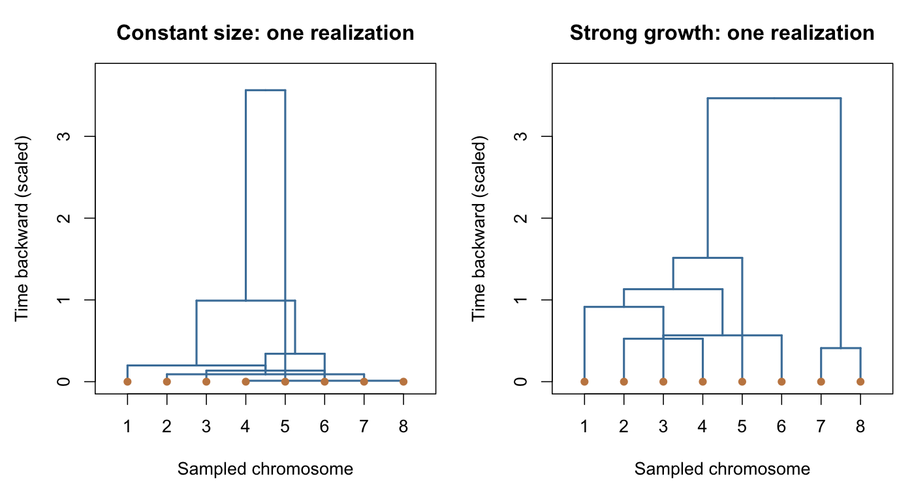
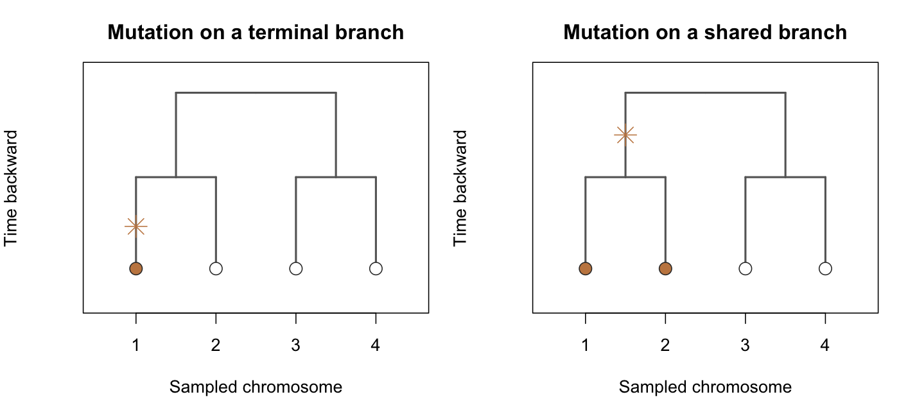

```{r setup, message=FALSE}
knitr::opts_chunk$set(echo = TRUE, fig.width = 8, fig.height = 4.5)
source("population_growth_sim.R")
set.seed(68113)
```

## Today's question

What can genetic differences among people sampled today tell us about past population expansion? We will use real measurements and **approximate Bayesian computation (ABC)** to keep a distribution of plausible growth parameters. The task is to compare simulated and observed features, as in SMM, but to retain multiple plausible parameter values rather than one best-fitting value.

The simulator and a bank of 50,000 prior simulations are supplied. You will implement rejection ABC with three summaries, see how the tolerance affects the result, and check whether all three summaries are needed.

## The measurements and model

Each row is one sampled Y chromosome and each column is one of eight markers. A marker records how many times a short DNA sequence repeats. A whole row is a *haplotype* (or *profile*). The columns share a paternal ancestry tree, while mutations at different markers occur independently along its branches.

```{r data}
observed <- as.matrix(read.csv("data/observed_repeat_counts.csv"))
dim(observed)
head(observed)
```

The 440 rows are a cleaned worldwide sample from the [Pritchard lab archive](https://web.stanford.edu/group/pritchardlab/dataArchive/ydata.html). Five original records had fractional repeat changes and were excluded before class; [data/README.md](data/README.md) records the conversion. People came from many populations. Our model treats them as if they came from one randomly mating population, so any inference is conditional on that simplification.

Looking backward, lineages merge when they reach a shared ancestor. Mergers are more likely in smaller populations. These are two *particular simulated trees*; growth does not force every tree to have this shape.



Mutations change a repeat count by one step up or down. A terminal-branch mutation affects one sampled chromosome; a mutation on a shared branch can affect several descendants. The orange leaves below inherit the marked mutation.



The unknowns we use are $\theta=2N_A\mu$ (mutation rate on the ancestral time scale), $\beta=rN_A$ (growth rate on that scale), and $\gamma=rt_g$ (total log expansion). The present-to-ancestral size ratio is $e^\gamma$. Here $N_A$ is the *effective* ancestral size governing how quickly lineages merge, not necessarily a literal headcount. These data do not separately identify $N_A$, mutation rate $\mu$, per-generation growth rate $r$, and growth duration $t_g$.

### The model in probability notation

Let $t$ be time in generations, measured backward from the present ($t=0$ is when the sample was taken), and let $u=t/N_A$ be the same time in units of $N_A$ generations. Relative to its ancestral size, the population at scaled time $u$ has size

$$
q(u)=\frac{N(u)}{N_A}=\begin{cases}
e^{\gamma-\beta u},&0\leq u<\gamma/\beta,\\
1,&u\geq\gamma/\beta.
\end{cases}
$$

Looking backward, the population shrinks exponentially from $e^\gamma$ times its ancestral size today to its ancestral size at $u=\gamma/\beta$ (that is, $t_g$ generations ago), and stays at that size before then.

**The ancestry tree $G$.** With $n=440$, the tree has $2n-1$ nodes. Nodes $1,\dots,n$ are the sampled chromosomes (the leaves), all at time $U_1=\dots=U_n=0$. Internal nodes are numbered in the order they appear going backward: node $n+m$ is the ancestor created by the $m$th merger, $m=1,\dots,n-1$. The last one, node $2n-1$, is the root, which is the most recent common ancestor of the whole sample. Each internal node $v$ carries two random quantities:

- $U_v$, its time, with $0<U_{n+1}<U_{n+2}<\dots<U_{2n-1}$;
- $\mathrm{ch}(v)$, the unordered pair of nodes that merge into $v$ (its two children).

The tree is the collection $G=\{(U_v,\mathrm{ch}(v)):v=n+1,\dots,2n-1\}$, and everything else about it follows from these variables. If $w\in\mathrm{ch}(v)$, then $v$ is the parent of $w$, written $\mathrm{pa}(w)=v$, and the branch above $w$ has length $\ell_w=U_{\mathrm{pa}(w)}-U_w$.

**Generating $G$ when the population size is constant.** First suppose $q(u)=1$ for all $u$. Then the tree is built backward from the present, one merger at a time. Let $A_m$ be the set of lineages that are still separate just before the $m$th merger. Thus $A_1=\{1,\dots,n\}$, and the two merging lineages are replaced by their parent: $A_{m+1}=\bigl(A_m\setminus\mathrm{ch}(n+m)\bigr)\cup\{n+m\}$. So $A_m$ contains $k_m=n-m+1$ lineages. Conditional on the more recent mergers, and taking $U_n=0$, the $m$th merger is drawn in two parts.

1. **Waiting time.** $U_{n+m}-U_{n+m-1}\sim\operatorname{Exponential}\bigl(\text{rate}=\binom{k_m}{2}\bigr)$.
2. **Which pair.** $\mathrm{ch}(n+m)$ is chosen uniformly from the $\binom{k_m}{2}$ pairs in $A_m$, independently of the waiting time.

Here is where these distributions come from. Two lineages share a parent one generation back with probability $1/N_A$. One unit of $u$ is $N_A$ generations, so a single pair merges after an Exponential(1) time. With $k$ lineages, $\binom{k}{2}$ pairs compete, and the first merger comes after the minimum of their waiting times. That minimum is Exponential with rate $\binom{k}{2}$, and each pair is equally likely to be the one that merges. Many lineages merge quickly. The final two take one time unit on average.

**Changing population size: rescaling time.** A larger population makes mergers proportionally slower. When the population is $q(u)$ times its ancestral size, each pair merges at rate $1/q(u)$ instead of 1. We handle this by running the constant-size process on a clock that ticks at rate $1/q(u)$:

$$
\Lambda(u)=\int_0^u\frac{dw}{q(w)}=\begin{cases}
e^{-\gamma}\bigl(e^{\beta u}-1\bigr)/\beta,&0\leq u\leq\gamma/\beta,\\
\bigl(1-e^{-\gamma}\bigr)/\beta+u-\gamma/\beta,&u>\gamma/\beta.
\end{cases}
$$

Concretely:

1. draw a constant-size tree with times $S_{n+1}<\dots<S_{2n-1}$ and children $\mathrm{ch}(v)$ as above;
2. keep the children, and convert each time to the real (scaled) time scale by $U_v=\Lambda^{-1}(S_v)$.

So growth changes only the merger times, not who merges with whom. The topology has the same distribution for every $(\beta,\gamma)$. Under strong growth, $q(u)$ is large near the present, so $\Lambda$ increases slowly there. A short stretch of constant-size time then maps to a long stretch of real time. Recent mergers are spread out and terminal branches are long, which gives the growth tree in the figure above its shape. Before the growth phase ($u>\gamma/\beta$), $\Lambda$ has slope 1, and the tree looks like a constant-size tree again. $G$ does not depend on $\theta$.

Equivalently, on the original time scale, each pair of separate lineages merges at rate $1/q(u)$. Steps 1–2 are how `simulate_data` generates the tree.

The likelihood $p(X\mid\theta,\beta,\gamma)$ would require averaging the mutation model over every possible tree, which means integrating over all $n-1$ merger times and summing over every sequence of merging pairs. That is the calculation we avoid by simulating.

**Mutation counts $M_{vj}^{\pm}$.** For marker $j\in\{1,\dots,8\}$ and the branch above node $v$, let $M_{vj}^{+}$ be the number of mutations on that branch that add one repeat, and $M_{vj}^{-}$ the number that remove one. A lineage mutates at rate $\mu$ per generation, or $N_A\mu=\theta/2$ per unit of $u$, and up and down steps are equally likely. Hence

$$
M_{vj}^{+},\,M_{vj}^{-}\mid G,\theta
\ \overset{\mathrm{ind}}{\sim}\ \operatorname{Poisson}(\theta\ell_v/4),
$$

independently across branches $v$, markers $j$, and the two directions. Only the tree is shared, so the mutation counts are independent **conditional on $G$**. This stepwise model ignores multi-step changes and any upper or lower bound on repeat counts.

**Repeat counts $X$.** Write $X_{vj}$ for the repeat count of node $v$ at marker $j$, meaning the number of copies of that marker's short sequence on that ancestral or sampled chromosome. Each child starts with its parent's count and adds the net change on its branch:

$$
X_{vj}=X_{\mathrm{pa}(v),j}+M_{vj}^{+}-M_{vj}^{-},\qquad v\neq 2n-1 .
$$

Starting from the root's counts and moving down the tree fixes every node's count. Equivalently, leaf $i$'s count is the root count plus the net mutations on every branch along its path to the root. The data are the leaf counts only, which form the $440\times 8$ matrix $X=(X_{ij})_{i\leq n,\,j\leq 8}$. Internal-node counts are never observed. Two leaves inherit every mutation on the branches they share, so the rows of $X$ are dependent even though the mutation counts are not. Leaves with a recent common ancestor tend to have similar or identical rows, and this is what the distinct-haplotype summary below picks up.

**The root's counts.** Let $c_j=X_{2n-1,j}$ be the root's repeat count at marker $j$, and let $c=(c_1,\dots,c_8)$ be the root's profile. We do not know $c$, and it clearly affects what the data look like: the observed columns are centered at very different values, from about 30 (DYS389c) to about 84 (DYS392). These are not literal repeat numbers either, because converting fragment lengths adds an arbitrary constant to each marker ([data/README.md](data/README.md)). We use a simple plug-in estimate. Mutations are equally likely to go up or down, so every leaf has expected count $E[X_{ij}\mid G]=c_j$. We therefore estimate $c_j$ by the rounded column mean, $\hat c_j=\operatorname{round}(\bar X_{\cdot j})$:

```{r root-estimate}
root_hat <- round(colMeans(observed))
root_hat
```

This is a weak estimate, and a careful analysis would do better. The 440 chromosomes share one tree, so they carry much less information about the root than 440 independent draws would. The sample also pools many populations. A better approach would treat $c$ as another unknown with a prior, or reconstruct it from the tree.

A plug-in estimate is enough here because $c_j$ shifts every entry in column $j$ by the same amount, and none of our three summaries changes under such shifts. Sample variance is shift-invariant, and diversity and the number of distinct haplotypes depend only on which entries are equal. So the root affects how the simulated data look, but not the ABC results. The supplied prior bank was simulated with $c=0$, and its summaries would be identical for any other root. A summary that is not shift-invariant, such as the mean repeat count, would mostly be measuring $c$. Using one would require a better treatment of the root.

**Generative recipe.** One simulated dataset is produced by:

1. drawing $(\theta,\beta,\gamma)$ from the prior below;
2. drawing $G\mid\beta,\gamma$ as a constant-size tree, then rescaling its times by $\Lambda^{-1}$;
3. drawing $M_{vj}^{\pm}\mid G,\theta$ on every branch and marker;
4. setting the root's counts to $\hat c$, propagating counts down the tree, and returning the $n\times 8$ leaf matrix.

For the simulation bank, the prior starts with independent draws of the original quantities, where $\delta=t_g/N_A$:

$$
\mu\sim\operatorname{Gamma}(10,\text{scale}=0.00008),\quad
\log N_A\sim N(8.5,2^2),\quad
r\sim\operatorname{Exponential}(\text{mean}=0.005),\quad
\delta\sim\operatorname{Gamma}(2,\text{scale}=1).
$$

Then $(\theta,\beta,\gamma)=(2N_A\mu,rN_A,rN_A\delta)$. These three scaled parameters therefore have a dependent prior. The distributions above describe the simulation inputs, not quantities measured directly from the 440 people.

The supplied `simulate_data(theta, beta, gamma, n, loci = 8, root = root_hat)` function carries out steps 2–4 and returns the integer leaf matrix. If `root` is omitted, it uses a root of zero at every marker. You do not need to implement the tree or mutations today.

Following [Beaumont, Zhang, and Balding (2002)](https://people.eecs.berkeley.edu/~jordan/sail/readings/beaumont-zhang-balding.pdf), we will use three summaries of the $n\times 8$ data matrix $X$, where $n=440$.

1. **Mean variance.** For each marker $j$, compute the sample variance of its repeat counts, $s_j^2=\frac{1}{n-1}\sum_{i=1}^n\bigl(X_{ij}-\bar X_{\cdot j}\bigr)^2$. Then average over markers:
$$
S_1=\frac{1}{8}\sum_{j=1}^8 s_j^2.
$$
2. **Mean diversity.** For marker $j$ and repeat count $a$, let $\widehat p_{ja}=\frac{1}{n}\#\{i:X_{ij}=a\}$ be the fraction of chromosomes with count $a$. The diversity of marker $j$ is $1-\sum_a\widehat p_{ja}^2$, which is the probability that two chromosomes drawn at random (with replacement) have different counts at that marker. Then average over markers:
$$
S_2=\frac{1}{8}\sum_{j=1}^8\Bigl(1-\sum_a\widehat p_{ja}^2\Bigr).
$$
Beaumont et al. and Pritchard et al. call $S_2$ the mean (effective) *heterozygosity*. The Y chromosome is haploid, so no one is actually heterozygous. The name refers to the chance that a diploid individual formed from two randomly drawn chromosomes would be heterozygous, which population geneticists also call *gene diversity*. Drawing the two chromosomes without replacement would multiply each marker's value by $n/(n-1)$. The with-replacement version used here reproduces the paper's value of 0.635.
3. **Number of distinct haplotypes.** A haplotype is a whole row $(X_{i1},\dots,X_{i8})$. $S_3$ is the number of different haplotypes among the $n$ rows. Two chromosomes have the same haplotype only if they match at all eight markers. So $S_3$ is between 1 (everyone identical) and $n$ (no two alike).

$S_1$ and $S_2$ look at one marker at a time. $S_3$ uses all eight markers jointly. The code labels these `mean_variance`, `mean_diversity`, and `distinct_profiles`. Run the supplied summary function.

```{r observed-summaries}
observed_summary <- summary_stats(observed)
observed_summary
```


Each bank row has one draw from the prior above and summaries from one simulated dataset of 440 individuals at eight linked markers.

```{r bank}
bank <- read.csv("data/prior_bank.csv.gz")
nrow(bank)
head(bank)
```

Look at selected views of the bank, for instance, `mean_variance` vs. `theta`, `distinct_profiles` vs. `gamma`, etc. You might need a log or started log transformation, $x\mapsto\log(1+x)$, to see the relationships clearly.

```{r bank-views}

```


**Discuss:** Which summaries appear to move with which parameters?

## Approximate conditioning

A haplotype count can differ by tens while diversity lies between zero and one, so we divide each summary's discrepancy by a scale $a_j$. A natural scale is how much that summary varies from one simulated dataset to the next, at parameter values that fit the data reasonably well. This is the same idea as weighting by inverse variance in SMM. The spread across the whole prior bank would be a poor choice. The bank has a long upper tail for variance, so its global spread would give variance almost no weight near our observation. Instead, we ran a rough first ABC analysis and rounded the center of its retained parameters to $(\theta,\beta,\gamma)=(1,4,5)$. We then simulated 500 datasets at that point. The scale $a_j$ is the standard deviation of summary $j$ across those 500 datasets. Nearby pilot points give very similar scales. The scales stay fixed for every tolerance below.

For simulation $i$, calculate

$$
z_{ij}=\frac{s_{ij}-s_{\mathrm{obs},j}}{a_j},
\qquad d_i=\sqrt{\sum_j z_{ij}^2}.
$$

The scales are computed from the supplied simulations at the pilot point:

```{r scales}
summary_names <- names(observed_summary)
scale_simulations <- read.csv("data/scale_simulations.csv")
scales <- apply(scale_simulations[, summary_names], 2, sd)
scales
```

**Task 1.** Implement rejection ABC. For every simulation in the bank, compute the standardized discrepancies $z_{ij}$ and the distance $d_i$. Then keep the simulations closest to the observed summaries: the closest 10%, 2%, and 0.5% of the *same* bank. In practice, keeping a fixed fraction is more common than choosing a fixed $\epsilon$. You can back out the implied $\epsilon$ afterwards, as the largest distance among the kept simulations.

```{r abc}

```

**Task 2.** Plot the prior distribution against the ABC posterior for each single parameter and for pairs of parameters. Compare the different tolerances.

```{r posteriors}

```

**Discuss:** What does the posterior tell you?


## Are fewer summaries enough?

In lecture we checked sufficiency through conditional independence. If $S$ is sufficient, then $\theta\perp X\mid S(X)$: once we know $S(X)$, nothing else about the data tells us more about the parameters. Here we ask a smaller, relative question: **is a subset of our three summaries as informative as all three?** If it is, then two things should happen.

- Among simulations whose kept summaries are close to the observed ones, a dropped summary should show no relationship with the parameters.
- Conditioning on the subset should give about the same posterior distribution as conditioning on all three.

**Task 3.** Write a function `abc_subset()` that runs your ABC procedure using only some of the summaries. Use the same scales as before. Then use it to run ABC three times, dropping a different summary each time, and compare the resulting posterior distributions with the one from all three summaries. Do some summaries seem to be more important for some parameters?

```{r subset-abc}

```

**Task 4.** For each pair of summaries, keep the closest 2% of the simulations to the observed data on that pair. Call these two the *kept* summaries and the third one the *dropped* summary. Then plot each log parameter against the dropped summary. Each plot gives an approximate picture of the joint distribution of the parameter and the dropped summary, given that the kept summaries are near their observed values. If the parameter still varies with the dropped summary, the dropped summary carries information about that parameter beyond what the kept summaries provide.

```{r dropped-summary-plots}

```

**Discuss:** Which dropped summaries are still related to which parameters? Do these plots agree with your comparison of posterior distributions in Task 3?

## Sources

- [Beaumont, Zhang, and Balding (2002)](https://people.eecs.berkeley.edu/~jordan/sail/readings/beaumont-zhang-balding.pdf), the ABC analysis adapted here.
- [Pritchard et al. (1999)](https://web.stanford.edu/group/pritchardlab/publications/pdfs/PritchardEtAl99a.pdf), the population-history model and underlying measurements.
- [Pritchard lab data archive](https://web.stanford.edu/group/pritchardlab/dataArchive/ydata.html); cleaning details are in [data/README.md](data/README.md).
